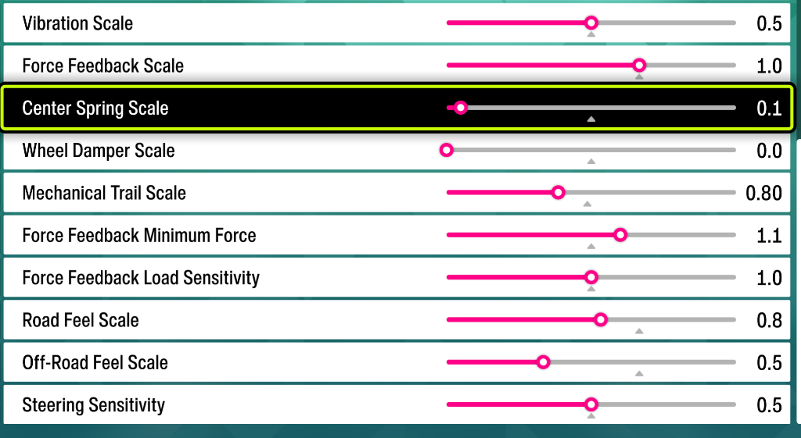

# Forza Horizon 6 — Universal Direct Drive FFB Physics Fix

Works for **all Direct Drive wheelbases** (Simucube 2 & 3, Fanatec DD1/DD2/CSL DD, Simagic, Asetek, VRS, Moza, Cammus, Conspit) across **Xbox App / Microsoft Store** and **Steam**.

---

## 1. Why Direct Drive Wheels Feel Bad Out of the Box in Forza Horizon 6

Forza Horizon 6 uses a **two-layer Force Feedback system**:
1. **Hidden Physics Lookup Tables (`Content\media\wheeltunablesettingspc.zip`)**: 47 per-wheel `.ini` files that define 75 internal physics parameters (tire grip windows, low-load center boost, road spike clamps, internal tire-slip damping, and smoothing filters) **before** the game ever mixes the FFB signal.
2. **In-Game Sliders**: 10 simple multipliers at the end of the chain.

Because Forza mixes all physics forces into one combined USB torque command *before* sending it to your wheelbase, **neither the in-game sliders nor your wheelbase software (Simucube Tuner, Moza Pit House, Fanatec Control Panel, SimPro) can "un-bake" bad hidden `.ini` curves.**

Specifically, Direct Drive owners get hit by one of two bugs in `wheeltunablesettingspc.zip`:
- **Bug #1 — Unrecognized Direct Drive Wheels (`Simucube 3`, `Simagic`, `Asetek`, `VRS`, newer `Moza`):**
  Because their USB IDs are missing from `wheeltunablesettingspc.zip`, Forza falls back to `ControllerFFB-0000000000.ini` (`Default`). `Default` has **no on-center low-load boost (`1.0`)**, **clips cornering grip early (`3.0`)**, adds **hidden internal tire-slip drag (`DampingAtMin/MaxSlip = 1`)**, and has **dull asphalt texture (`0.35`)** with a **high curb-spike ceiling (`0.50`)**.
- **Bug #2 — Legacy Direct Drive Profiles (`Simucube 2`, `Fanatec DD1 / DD2`):**
  Even worse, `ControllerFFB-0X16D00D60.ini` (`Simcube 2 Sport`) and `0x0eb70006.ini` / `0x0eb70007.ini` (`Fanatec DD1/DD2`) are the *only* files in the game where Playground Games enabled a heavy internal spring-damper filter (`SteerTorqueShouldSmooth = true`, `SpringK = 10000`, `SpringD = 3.0`), forced a `0.25` minimum damper floor, and locked caster flat at `9.0 -> 9.0`—making the wheel feel like **turning through molasses** the further you turn.

---

## 2. What This Patch Does

Meanwhile, inside the same `wheeltunablesettingspc.zip` archive, Playground Games included a modern Direct Drive physics tune (`ControllerFFB-0X046DC272.ini`, created for an 11 Nm Direct Drive servo) that fixes every single one of those issues:

| Hidden `.ini` Parameter | Stock `Default` (`0000000000.ini`) | Stock `SC2 / DD1 / DD2` (`0X16D00D60.ini`) | **Patched Modern DD Curve** |
| :--- | :--- | :--- | :--- |
| **`SteerTorqueShouldSmooth`** *(Molasses Filter)* | `false` | `true` (`K=10000, D=3.0`) | **`false` (Clean, unfiltered)** |
| **`SteerTorqueMinNormLoadOut0`** *(On-Center Feel)* | `1.0` *(Vague center)* | `1.25` | **`1.25` (+25% center feel)** |
| **`SteerTorqueMin -> MaxLatFric`** *(Cornering Grip Window)* | `1.0 -> 3.0` *(Clips early)* | `2.0 -> 3.0` | **`1.5 -> 3.5` (Wider grip range)** |
| **`PneumaticCasterScaleMin -> Max`** *(Self-Aligning Pull)* | `8.5 -> 7.5` | `9.0 -> 9.0` *(Overpowering)* | **`7.0 -> 7.0` (Natural & smooth)** |
| **`DampingAtMin / MaxSlip`** *(Hidden Tire-Slip Drag)* | `1 / 1` *(Artificial drag)* | `1 / 1` | **`0 / 0` (Zero fake slip drag)** |
| **`RoadFeelScaleAsphalt`** *(Small Road Texture)* | `0.35` *(Muted)* | `0.50` | **`0.60` (Rich road surface detail)** |
| **`RoadFeelTorqueClamp`** *(Harsh Curb/Pothole Ceiling)* | `0.50` *(Harsh jolts)* | `0.35` | **`0.30` (Clamps violent spikes)** |

Running **`Install_FH6_DirectDrive_Fix.bat`** automatically backs up your stock `wheeltunablesettingspc.zip` and applies this clean Modern Direct Drive curve (with positive `DynFFBScale = 1`) to:
- `ControllerFFB-0000000000.ini` (`Default` — automatically covers **any** unrecognized DD wheel: Simucube 3, Simagic, Asetek, VRS, Cammus, Moza, etc.)
- `ControllerFFB-0X16D00D60.ini`, `0X16D00D5F.ini`, `0X16D00D65.ini`, `0X16D00D66.ini` (`Simucube 2 & Simucube 3`)
- `ControllerFFB-0x0eb70006.ini` & `0x0eb70007.ini` (`Fanatec DD1 & DD2`)

*(Note: Forza uses a proprietary `.zip` format where every file's compressed payload must start on a 4096-byte page boundary with a custom `0x1123` extra-field header. Editing the `.zip` with 7-Zip or WinRAR breaks the file—this installer uses a built-in C# packer that preserves Forza's exact 4096-byte page alignment).*

---

## 3. Recommended Wheelbase Software Settings (Any Brand)

To pair with this physics curve, set your wheelbase software (**Simucube Tuner**, **Moza Pit House**, **Fanatec Control Panel**, **Simagic SimPro**, **Asetek RaceHub**, **VRS**) as follows:

1. **Max Torque / Peak Force:** **`9.0 – 11.0 Nm`** (`10.5 Nm` sweet spot)
2. **Steering Range:** **`900°`** (`450°` per side)
3. **Damping:** **`5% – 6%` (CONSTANT / FLAT)**
   - **Important for Simucube 3 / Tuner users:** Default Simucube 3 profiles use an angle-ramping damping curve that ramps damping up between `5%` and `40%` steering angle—flatten that curve or use simple constant damping (`6%`), otherwise your wheelbase software itself will create a "turning through molasses" ramp-up!
4. **Inertia:** **`0% / Off`**
5. **Friction:** **`2%`**
6. **Slew Rate / Effect Aggressiveness / Reconstruction:** Moderate (`~55%` Aggressiveness, `60%` Detail, `20%` HF Attenuation in Simucube Tuner; Filter `3–4` in TrueDrive/Fanatec)
7. **Synthetic UDP Telemetry Effects (Cornering Spring / Road Texture):** **`Off`** (let Forza's native physics FFB come through cleanly)

---

## 4. Recommended In-Game Settings (FH6 Advanced Controls)

- **Steering Axis Deadzone Inside / Outside:** `0` / `100`
- **Vibration Scale:** `0.5`
- **Force Feedback Scale:** `1.0`
- **Center Spring Scale:** `0.1`
- **Wheel Damper Scale:** `0.0` *(let your wheelbase servo handle damping cleanly)*
- **Mechanical Trail Scale:** `0.80`
- **Force Feedback Minimum Force:** `1.1`
- **Force Feedback Load Sensitivity:** `1.0`
- **Road Feel Scale:** `0.8`
- **Off-Road Feel Scale:** `0.5`
- **Steering Sensitivity:** `0.5`

---

## 5. How to Install / Uninstall

- **To Install:** Double-click **`Install_FH6_DirectDrive_Fix.bat`** (then restart Forza Horizon 6 if it's running).
- **To Revert to Stock:** Double-click **`Uninstall_Restore_Stock.bat`**.
